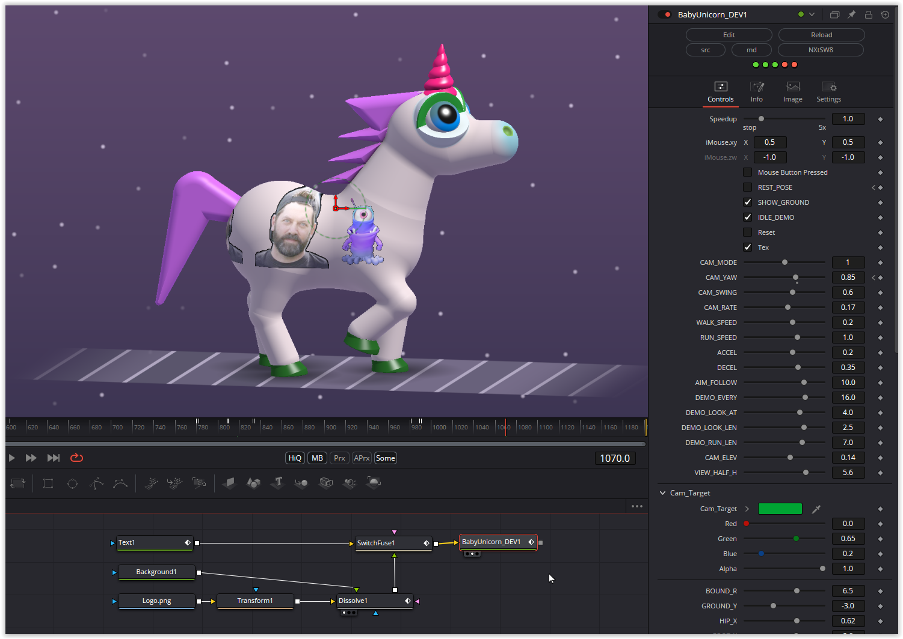

This conversion wasn't entirely easy; due to two simple errors, this shader initially didn't run at all. Extensive debugging then led us on the right track.
And this time you can change almost everything at runtime. I have implemented all the prepared parameters and added a few more. Almost all colors can be changed, the shapes and angles, as well as the flow.
In addition, a texture can be displayed on the unicorn (see Gif). This can be limited to the body using the Tex_Thres parameter. If you want to specify a complete texture for the Unicorm itself, you only have to set the value to zero, so all parts of the skin will be provided with the texture.
A total of 5 switches, 64 parameters, 2 point parameters and 27 colors are available.
Have fun playing

### Description of the Shader in Shadertoy:
Sprite shader for a game I'm working on.
A full version of my js13k entry: [url]https://js13kgames.com/games/unicx[/url]

Click for head look and gallop.
