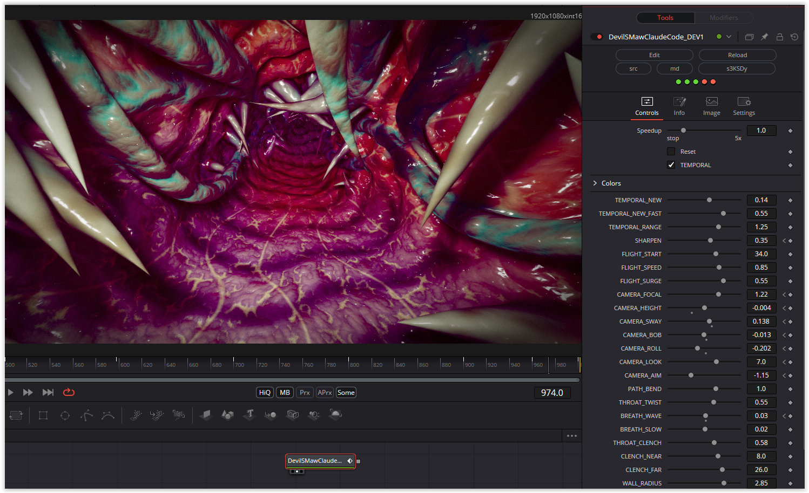

The conversion process was a lot of fun once again. There is an incredible number of parameters to work with. In the original, the shader is, in my opinion, far too dark—to the point where the fantastic reflections and color gradients are almost lost—but a quick tweak to the `TONE_MIDDLE` parameter makes a world of difference.

Enjoy the shader!

### Description of the Shader in Shadertoy:
You've been swallowed, and all you have is a lamp. The throat stays clenched shut until you reach it, then opens just enough to let you further down. Fangs and tentacles come out
of the dark as you go.